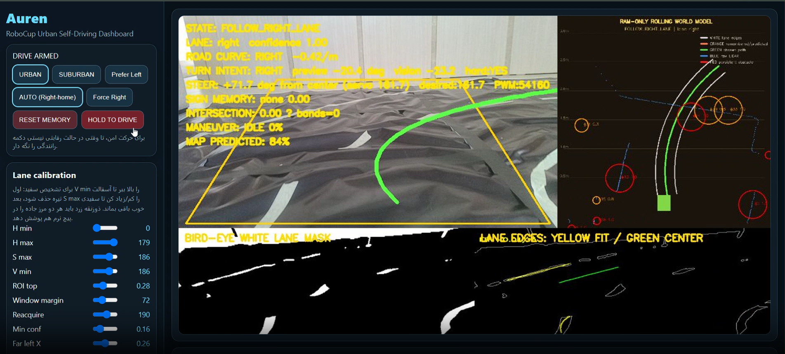

# Auren — Lane Detection for Autonomous Driving

Lane-perception and path-geometry module developed for our **RoboCup Iran Open 2026** urban self-driving robot.

The module extracts road boundaries from camera frames, estimates a drivable centerline in robot-relative metric coordinates, and provides curve geometry for downstream path planning and steering control.

<p align="center">
  
</p>

## Highlights

- **White-lane segmentation:** HSV-based masking with configurable thresholds and adaptive processing.
- **Bird's-eye perspective:** perspective transformation to simplify lane geometry.
- **Temporal tracking:** previous-frame seeds and corridor memory to improve continuity.
- **Boundary fitting:** paint-edge extraction, left/right boundary pairing, and centerline estimation.
- **Curve handling:** signed-curvature estimation, direct curve fitting, and curve-latch logic.
- **Fallback behavior:** single-boundary recovery and short-term geometry memory when markings are partially lost.
- **Automated tests:** unit tests for curve fitting, lane-boundary pairing, and tracking behavior.

## Repository layout

```text
auren-lane-detection/
├── assets/
│   └── robocup-urban-dashboard.png
├── config/
│   └── robot.json
├── src/
│   └── worldcar/
│       ├── controller.py
│       ├── direct_curve.py
│       ├── edge_curve.py
│       ├── geometry.py
│       ├── lane_gpu_worker.cpp
│       ├── lane_gpu_worker.py
│       ├── lane_neural.py
│       ├── lane_perception.py
│       └── models.py
├── tests/
│   ├── test_direct_curve.py
│   └── test_edge_curve.py
├── requirements.txt
└── README.md
```

## Pipeline overview

1. **Preprocess the camera image** and apply the configured region of interest.
2. **Segment lane paint** using HSV thresholds and morphology.
3. **Warp to bird's-eye view** using the perspective points in `config/robot.json`.
4. **Extract candidate boundaries** and fit their geometry.
5. **Track lane identity over time** and recover from partial or temporary loss of a boundary.
6. **Estimate the centerline and curvature** in robot-relative coordinates.
7. **Pass the resulting path geometry** to the vehicle's planning and control components.

The perception module represents points in robot coordinates with **x forward** and **y left**.

## Requirements

- Python 3.10+
- NumPy
- OpenCV-Python

Install the Python dependencies:

```bash
python -m venv .venv
```

Activate the environment, then run:

```bash
python -m pip install -r requirements.txt
```

## Configuration

The main configuration is `config/robot.json`. It contains camera dimensions, perspective-transform points, HSV thresholds, sliding-window settings, lane-width assumptions, tracking parameters, and curve-fitting options.

Tune the configuration for the camera position, image resolution, road markings, and vehicle geometry used on your platform.

## Run the tests

From the repository root:

```bash
python -m unittest discover -s tests -v
```

The tests exercise selected geometry and perception behaviors. They do not replace on-robot validation.

## Integration notes

This repository contains the lane-perception and related geometry/control modules, rather than a complete standalone vehicle application. The camera capture loop, robot-specific hardware interface, and full runtime orchestration must be provided by the integrating application.

The optional neural lane path is configured through `neural_model`. If enabled, provide a compatible ONNX model. The C++ worker is an optional TensorRT/CUDA sidecar and requires the corresponding NVIDIA development libraries and a compatible serialized engine; it is not required for the HSV-based perception path.

## Safety

This software is intended for robotics research and controlled testing. Validate behavior at low speed in a secured test area before running on a real vehicle. Do not rely on lane perception alone as a safety system.

## Project

**Event:** RoboCup Iran Open 2026  
**Area:** Autonomous driving / lane perception  
**Project name:** Auren
